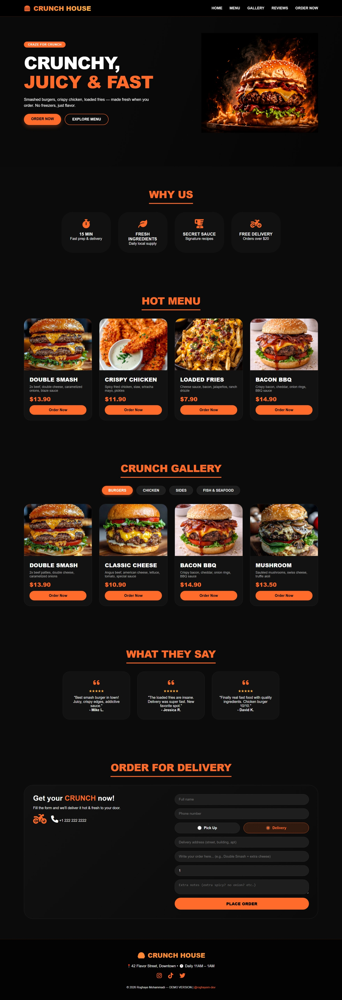

# 🍔 Fast Food Landing Page

A modern and responsive Fast Food Landing Page built using HTML, CSS, and JavaScript. This project features an attractive restaurant design, smooth navigation, and a mobile-friendly layout.

---

## 🌟 Live Demo

👉 View Live Demo: [https://roghayem.github.io/fastfood-landing-page/](https://roghayem.github.io/fastfood-landing-page/)

---

## 🖼️ Preview



---

## ✨ Features

- Modern and attractive fast-food landing page
- Fully responsive design for desktop, tablet, and mobile devices
- Smooth user experience with JavaScript interactions
- Clean UI with custom styling
- Easy navigation between sections
- Food showcase section

---

## 🛠️ Built With

- HTML5
- CSS3
- JavaScript (ES6)
- CSS Flexbox
- CSS Grid
- Media Queries

---

## 🚀 Getting Started

To run this project locally:

1. Clone the repository:

   ```bash
   git clone https://github.com/roghayem/fastfood-landing-page.git
   ```

2. Open the project folder:

   ```bash
   cd fastfood-landing-page
   ```

3. Open `index.html` in your browser.

---

## 📂 Project Structure

```text
fastfood-landing-page/
│
├── index.html
├── style.css
├── script.js
├── assets/
│   └── Screenshot_1-6-2026_21349_127.0.0.1.jpeg
└── README.md
```

---

## 📚 What I Learned

Through this project, I practiced:

- Building a restaurant landing page using HTML
- Creating responsive layouts with Flexbox and CSS Grid
- Using media queries for different screen sizes
- Adding JavaScript interactions
- Organizing page sections and navigation
- Improving my frontend development skills

---

## 👩‍💻 Author

**Roghaye Mohammadi**

- GitHub: [@roghayem](https://github.com/roghayem)

---

⭐ If you like this project, feel free to give it a star!
